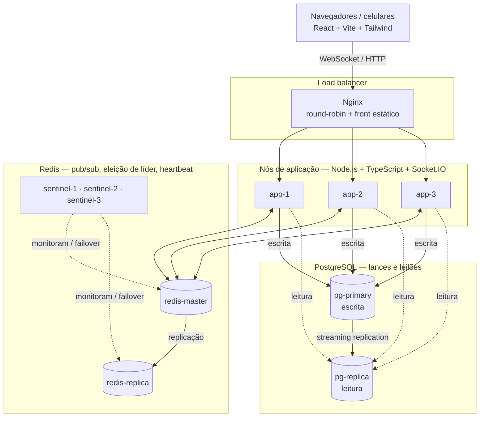

# Leilão Distribuído

Leilão online em tempo real rodando em um cluster com 3 nós de aplicação, Redis com Sentinel e PostgreSQL com réplica.

## Arquitetura



## Requisitos

Docker (com Compose), Make e Node.js 24+ (só para o script de teste).

## Rodando

```bash
make install   # dependências locais (necessário para o script de teste)
make run       # builda e sobe tudo
```

- Leilões: <http://localhost:8080>
- Painel do cluster: <http://localhost:8080/painel>

Para a turma entrar pelo celular, abra o painel pelo IP da máquina na rede (ex.: `http://192.168.0.10:8080/painel`) e mostre o QR code.

| Comando | O que faz |
| --- | --- |
| `make help` | Lista todos os comandos |
| `make status` | Estado do cluster (líder, nós, Redis, Postgres) |
| `make logs S=app-1` | Logs de um serviço (sem `S`, todos) |
| `make down` | Para e remove os containers |
| `make reset` | Apaga containers, volumes e imagens e sobe do zero |

## Roteiro da demonstração

Deixe o painel projetado e a turma dando lances pelo celular.

```bash
# 1. Sincronização: 50 robôs em nós diferentes dão o mesmo lance ao mesmo tempo → 1 vencedor
make teste ROBOS=50

# 2. Queda de um nó de aplicação: os clientes reconectam em outro nó
make kill-app N=2
make start-app N=2

# 3. Queda do líder: outro nó é eleito em ~5 s e assume o encerramento dos leilões
make kill-lider

# 4. Queda do Redis master: o Sentinel promove a réplica
make redis-failover

# 5. Queda do Postgres primário: o líder promove a réplica; lances em andamento são reenviados
make pg-failover

# Religa o que foi derrubado
make up
```

Depois do passo 5, rode `make reset` antes de repetir a demonstração: o primário antigo volta isolado e não vira réplica sozinho.
